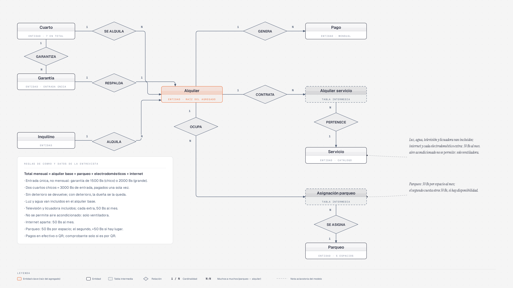

# UNIDAD 1 – ENTREVISTA Y DISEÑO LÓGICO DE LA BASE DE DATOS

---

## 1. INTRODUCCIÓN

El presente proyecto tiene como finalidad diseñar e implementar una base de datos para un Sistema de Gestión de Alquiler de Cuartos, orientado a facilitar la administración de viviendas, habitaciones, inquilinos, alquileres, servicios adicionales, espacios de parqueo y pagos.

El sistema está diseñado para administrar varias casas, permitiendo que cada administrador gestione la información correspondiente a su vivienda. Asimismo, contempla un perfil de superadministrador encargado de las funciones generales del sistema y una estructura de usuarios y perfiles para organizar los accesos.

Mediante una base de datos relacional implementada en MariaDB, se busca centralizar la información, mantener las relaciones entre los registros, facilitar las operaciones administrativas y reducir los errores derivados de la duplicación de datos.

El desarrollo utiliza PHP para la comunicación entre la aplicación web y la base de datos, mientras que MariaDB se ejecuta localmente mediante XAMPP y se administra con DBeaver.

---

## 2. ENTREVISTA AL ENCARGADO DEL ALQUILER

Para identificar las necesidades del sistema, se plantea una entrevista orientada a conocer los procedimientos de administración de las casas, el control de los cuartos, la gestión de los alquileres y el registro de los pagos.

**Entrevistador:** ¿Cómo se organiza la administración de las casas?

**Encargado:** El sistema debe permitir administrar varias casas. Cada administrador debe poder gestionar la información de la vivienda que tiene asignada, sin interferir en la administración de las demás casas.

**Entrevistador:** ¿Qué tipos de usuarios necesita el sistema?

**Encargado:** Se necesita un superadministrador para las tareas generales y administradores que gestionen sus respectivas casas. También se deben contemplar los datos de los inquilinos relacionados con los alquileres.

**Entrevistador:** ¿Qué información se necesita para administrar los cuartos?

**Encargado:** Se requiere registrar la información de cada cuarto y mantener el control de su disponibilidad, sus características y los datos relacionados con su alquiler.

**Entrevistador:** ¿Cómo se registran los alquileres?

**Encargado:** Se necesita relacionar cada alquiler con el cuarto correspondiente y registrar la información necesaria para administrar la ocupación y las condiciones acordadas.

**Entrevistador:** ¿Existen servicios adicionales?

**Encargado:** Sí. Se pueden ofrecer servicios y adicionales, como internet, electrodomésticos y parqueo. Cada casa debe poder manejar los precios que correspondan a sus propias condiciones.

**Entrevistador:** ¿Cómo se administran los precios de los servicios?

**Encargado:** Los administradores deben poder definir los precios de los servicios y adicionales de su casa. Si un administrador registra un electrodoméstico personalizado, este debe estar disponible únicamente para la vivienda a la que pertenece.

**Entrevistador:** ¿Cómo se controlan los cambios de precios?

**Encargado:** Es importante conservar la información histórica de las tarifas y evitar que un cambio de precio modifique los importes correspondientes a operaciones anteriores.

**Entrevistador:** ¿Cómo se registran los pagos?

**Encargado:** El sistema debe permitir registrar los pagos relacionados con los alquileres y organizar el detalle de los conceptos cobrados. También se contempla el uso de QR y efectivo como métodos de pago.

**Entrevistador:** ¿Cómo se entregan los comprobantes de pago?

**Encargado:** Se requiere que la administradora pueda disponer de un recibo con el detalle del pago para descargarlo y compartirlo con el inquilino cuando sea necesario.

**Entrevistador:** ¿Cómo se controla el acceso al sistema?

**Encargado:** Se necesita validar las credenciales, controlar el estado de las cuentas y mantener registros de las sesiones y los eventos relacionados con los accesos.

**Nota:** La entrevista anterior está redactada como una descripción de los requerimientos del proyecto. Si se necesita presentar como una entrevista efectivamente realizada, las respuestas deben verificarse con la persona entrevistada.

---

## 3. REQUERIMIENTOS DEL SISTEMA

A partir de las necesidades identificadas y de la estructura del sistema, se establecen los siguientes requerimientos funcionales.

### 3.1. Administración de casas y cuartos

- Registrar y administrar las casas incorporadas al sistema.
- Registrar los cuartos pertenecientes a cada casa.
- Mantener organizada la información de los cuartos y sus características.
- Controlar la disponibilidad de las habitaciones de acuerdo con las operaciones de alquiler.

### 3.2. Administración de usuarios

- Registrar los datos personales asociados a los usuarios.
- Administrar las cuentas de acceso y sus estados.
- Diferenciar los perfiles de superadministrador, administrador e inquilino.
- Relacionar a los administradores con las casas que tienen asignadas.
- Restringir las operaciones según los permisos y las responsabilidades de cada perfil.
- Registrar información relacionada con las sesiones y los intentos de acceso.

### 3.3. Administración de alquileres

- Registrar los alquileres y relacionarlos con los cuartos correspondientes.
- Mantener la información necesaria para administrar las condiciones del alquiler.
- Organizar los datos complementarios de los alquileres.
- Registrar las garantías relacionadas con las operaciones cuando corresponda.

### 3.4. Servicios adicionales y parqueos

- Administrar los servicios adicionales disponibles.
- Relacionar los servicios contratados con los alquileres correspondientes.
- Permitir la administración de precios según la casa.
- Diferenciar los adicionales personalizados registrados por cada administrador.
- Registrar y administrar los espacios de parqueo y sus asignaciones.
- Mantener un historial de precios para facilitar el seguimiento de las variaciones.

### 3.5. Pagos y recibos

- Registrar los pagos relacionados con los alquileres.
- Organizar los conceptos que forman parte de cada pago.
- Contemplar los métodos de pago mediante QR y efectivo.
- Relacionar los recibos con los pagos correspondientes.
- Preparar la generación de recibos descargables con el detalle de los importes cobrados.

La descarga del recibo en PDF y su distribución por WhatsApp se consideran funcionalidades que deben implementarse y verificarse antes de declararlas terminadas.

### 3.6. Seguridad y auditoría

- Validar las credenciales de acceso.
- Controlar el estado de las cuentas y los intentos fallidos de inicio de sesión.
- Administrar las sesiones de los usuarios.
- Registrar eventos relacionados con el acceso.
- Disponer de una estructura para la auditoría de las operaciones.

---

## 4. DISEÑO LÓGICO DE LA BASE DE DATOS

El diseño lógico representa la organización de la información mediante tablas y relaciones. Cada tabla almacena datos de una entidad o proceso del sistema, mientras que las claves primarias permiten identificar los registros y las claves foráneas establecen relaciones entre ellos.

La base de datos utilizada es `alquiler_cuartos`, implementada en MariaDB. Su estructura contempla tablas para la administración de las viviendas, los usuarios, los alquileres, los servicios adicionales, los pagos y los controles de acceso.

### 4.1. Tablas principales

| Tabla | Descripción |
|---|---|
| `casa` | Almacena la información de las casas administradas por el sistema. |
| `cuarto` | Organiza la información de los cuartos pertenecientes a las casas. |
| `persona` | Almacena los datos personales de las personas registradas. |
| `usuario` | Contiene las cuentas de acceso, sus credenciales y su estado. |
| `perfil` | Define los perfiles y la configuración de acceso de los usuarios. |
| `usuario_casa` | Relaciona a los usuarios con las casas que tienen asignadas. |
| `alquiler` | Registra las operaciones de alquiler. |
| `detalle_alquiler` | Organiza la información complementaria de los alquileres. |
| `garantia` | Almacena información relacionada con las garantías. |
| `servicio` | Contiene el catálogo de servicios adicionales. |
| `alquiler_servicio` | Relaciona los alquileres con los servicios contratados. |
| `parqueo` | Registra los espacios de estacionamiento. |
| `asignacion_parqueo` | Organiza las asignaciones de los espacios de parqueo. |
| `historial_precio` | Permite registrar información sobre los cambios de precios. |
| `pago` | Almacena los registros principales de los pagos. |
| `detalle_pago` | Organiza los conceptos relacionados con cada pago. |
| `recibo` | Contiene la información asociada a los recibos. |
| `sesion` | Administra la información de las sesiones de los usuarios. |
| `bitacora_acceso` | Registra eventos relacionados con los accesos al sistema. |
| `bitacora_auditoria` | Está destinada al registro de eventos de auditoría. |

La lista anterior corresponde a las tablas identificadas en la estructura de trabajo del proyecto. Para presentar el modelo definitivo, sus nombres y relaciones deben contrastarse con el esquema SQL actualizado.

### 4.2. Relaciones entre las tablas

Las relaciones principales del modelo lógico se organizan de la siguiente manera:

- Una casa puede tener varios cuartos.
- Una casa puede estar relacionada con varios usuarios mediante la tabla `usuario_casa`.
- Un usuario se asocia con un perfil que determina su configuración de acceso.
- Una persona puede estar relacionada con una cuenta de usuario.
- Un cuarto puede participar en diferentes operaciones de alquiler a lo largo del tiempo, de acuerdo con las reglas de disponibilidad.
- Un alquiler puede relacionarse con información complementaria y una garantía, según corresponda.
- Un alquiler puede incluir varios servicios adicionales.
- Un servicio puede estar relacionado con diferentes alquileres.
- Los espacios de parqueo pueden tener asignaciones registradas.
- Un alquiler puede relacionarse con registros de pagos.
- Un pago puede contar con varios conceptos detallados.
- Un pago puede relacionarse con la información de su recibo.
- Un usuario puede tener registros de sesión y eventos de acceso.

Las cardinalidades definitivas, así como las claves primarias y foráneas de cada relación, deben representarse según las restricciones reales de la base de datos.

### 4.3. Diagrama relacional

El diagrama relacional permite visualizar la estructura lógica de la base de datos, incluyendo las tablas, sus atributos, las claves primarias (PK), las claves foráneas (FK) y las relaciones existentes.

En este diagrama se debe reflejar la organización multi-casa del sistema, la separación entre usuarios y perfiles, la administración de los alquileres, los servicios adicionales y los pagos, así como las tablas de control de acceso y auditoría.

**Figura 1. Diagrama relacional de la base de datos `alquiler_cuartos`.**

*Nota: la imagen debe actualizarse si corresponde a una versión anterior del modelo, de manera que coincida con las tablas y relaciones actuales de MariaDB.*

---

## 5. CONCLUSIÓN

El análisis de los requerimientos y el diseño lógico permiten establecer una estructura organizada para la gestión de alquileres de cuartos. La identificación de las entidades, sus atributos y las relaciones constituye una base para el funcionamiento de la aplicación web.

La organización de la base de datos contempla la administración de varias casas, la asignación de usuarios y perfiles, el registro de alquileres, la gestión de servicios adicionales y parqueos, y el control de pagos y recibos.

Asimismo, las tablas relacionadas con las sesiones y la auditoría contribuyen a establecer una estructura para el seguimiento de los accesos y las actividades del sistema.

De esta manera, el diseño lógico de `alquiler_cuartos` sirve como fundamento para mantener la información organizada y continuar desarrollando las funcionalidades administrativas del Sistema de Gestión de Alquiler de Cuartos.
